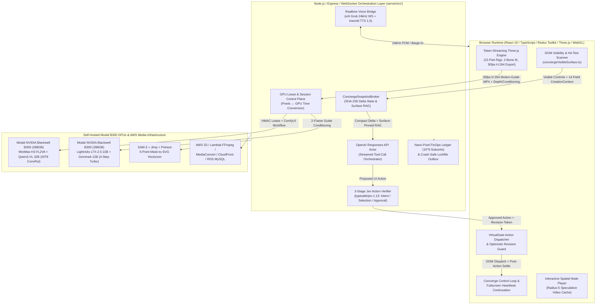
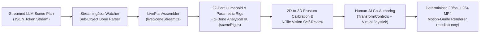

# ClikB — Autonomous GUI Control, Spatial Motion Blockout & Multimodal Creation Platform

**Live Platform:** [clikb.com](https://clikb.com)  
**Author & Lead Systems Architect:** Tega Ogheneovo

ClikB is a full-stack AI creation, interactive spatial storytelling, and autonomous GUI-control platform spanning **~300,000 lines of TypeScript, React, Node.js, GLSL, and Python** across a browser runtime, an Express/WebSocket orchestration backend, AWS serverless media pipelines, and self-hosted **NVIDIA Blackwell B300 (288 GB VRAM)** GPU inference clusters on Modal.

Rather than treating generative AI as a passive prompt-to-asset wrapper, ClikB implements **six tightly coupled systems**:

1. **Concierge Autonomous GUI Agent & 3-Stage Actor–Verifier Runtime (`VirtualGate` + `typesafe/jev-1.13`)**: Operates the live React/DOM application via visibility-verified control snapshots, SHA-256 delta state tracking, three independent verification gates, optimistic concurrency checks, idempotent paid-generation scopes, and autonomous multi-turn background continuation.
2. **Real-Time Token-Streaming Three.js Spatial & Motion-Blockout Engine**: Incrementally compiles partial JSON token streams from reasoning LLMs directly into live WebGL scenes (`LivePlanAssembler`), driving 22-part procedural humanoid rigs, analytical two-bone inverse kinematics (IK), reference-frame matrix cancellation, 2D-to-3D frustum calibration, 6-tile WebGL vision self-review, live virtual-joystick motion capture, and deterministic 30 fps H.264 MP4 motion-guide exports (`mediabunny`).
3. **Self-Hosted NVIDIA Blackwell B300 (288 GB) Video Diffusion Clusters (`modal_apps/`) & Dual-Currency Lease Plane**: Deploys **MiniMax-H3 FL2VA** (`Qwen3-VL 32B` + Wan2.1 VAE) and **Lightricks LTX-2.5 22B** (`Gemma4-12B`) on Modal B300 GPUs using `INT8 ConvRot` pruned weights, 50→4 step distillation (`LTX-2.3-22B-Distilled-LoRA`, sigma shifts `6.0`/`3.0`), `FirstBlockCache`, `EasyCache`, and `SageAttention 1.0.6` (`sm_100`), coupled to a real-time **Pixels ↔ GPU Time** lease-accounting plane.
4. **Interactive Spatial Node-Graph Player & `SAM-3` + `Potrace` Branching Video Engine**: Zero-flash double-`rAF` interactive branching video player backed by a radius-5 speculative LRU RAM preloader (`spatialVideoCache.ts`) and a 5-point `SAM-3` → `Jimp` → `Potrace` SVG Bezier hotspot vectorization pipeline.
5. **Full-Duplex Realtime Voice Concierge & 15+ Multimodal Model Router**: Dual-socket 24 kHz PCM voice runtime (`xAI Grok Realtime` WebSocket + `Inworld TTS 1.5`) with deterministic barge-in cancellation, text/voice turn handoff, and multi-provider media routing across OpenAI, Google Vertex/Gemini, Replicate, fal.ai, xAI, and Modal.
6. **Nano-Pixel (`10^9` Subunit) FinOps Metering, Crash-Safe Outbox & Multi-Device Draft Sync**: Exact integer subunit billing (`1 Pixel = 1,000,000,000 Subunits`), PID-aware lockfile outbox recovery (`meteredUsageOutbox.ts`), Stripe webhook idempotency, and revision-checked IndexedDB/S3/MySQL draft persistence.

---

## System Architecture Overview



---

## 1. Concierge Autonomous GUI Agent & 3-Stage Actor–Verifier Architecture

Unlike brittle selector-scraping agents, Concierge operates ClikB through a closed-loop **Actor–Verifier** runtime that separates high-level planning from deterministic UI action verification and execution safety.

### Visibility-Verified DOM Surface Extraction & Delta Snapshots
- **DOM Occlusion & Hit-Testing ([`src/conciergeVisibleSurface.ts`](src/conciergeVisibleSurface.ts))**: Scans candidate `[data-vg-id]` controls, filters out hidden, disabled, off-viewport (`< 4×4 px`), or background-layer elements (`resolveTopDialogLayer`), and runs 5-point `document.elementFromPoint` hit-testing (center + inset corners) to verify that controls are genuinely clickable and not occluded by modals or overlays.
- **SHA-256 Delta Snapshot Broker ([`server/src/ConciergeSnapshotBroker.ts`](server/src/ConciergeSnapshotBroker.ts))**: Maintains per-session snapshot baselines. Unchanged turns emit compact `no_change` markers with SHA-256 hashes; state transitions emit structured diffs (`addedControls`, `removedControls`, `changedControls`, `contextChanges`) alongside a 14-field [`CreationContext`](server/src/VirtualGate.ts) state vector.
- **Surface-Pinned Operational RAG ([`src/RagInstructionsGenerator.ts`](src/RagInstructionsGenerator.ts), [`docs/apps live rag fro app control/`](docs/apps%20live%20rag%20fro%20app%20control/))**: Automatically pins deterministic operational runbooks (`clikb_navigation`, `clikb_feeds`, `clikb_creation`, `clikb_deck`) whenever the active UI surface changes, supplemented by vector-embedded semantic recall ([`server/src/RagVectorService.ts`](server/src/RagVectorService.ts)) only on explicit knowledge queries.

### Three-Stage `typesafe/jev-1.13` Verification Gate
Every GUI action proposed by the Actor (`OpenAI Responses API`) must pass through [`server/src/JevActionGate.ts`](server/src/JevActionGate.ts) and [`server/src/JevDecisionService.ts`](server/src/JevDecisionService.ts), backed by a dedicated low-latency verifier model (`OpenRouter typesafe/jev-1.13`, `temperature: 0`, strict JSON schema):
1. **Stage 1 — Intent Resolution (`resolveIntent`)**: Extracts `immediate_target`, `intended_outcome`, `workflow_goal`, `final_stop_condition`, and classifies whether the action crosses a destructive or paid-generation boundary.
2. **Stage 2 — Live Control Selection (`selectAction`)**: Matches the resolved intent against the live `VirtualGateSnapshot` control registry (`target_control_id`, `action_type`, `value`).
3. **Stage 3 — Policy Approval (`approveAction`)**: Verifies preconditions, blocks unsafe or premature publish/generation actions (`approved` / `blocked` / `needs_confirmation`), and enforces deterministic overrides when single-step live transitions are unambiguous.

### Optimistic Concurrency, Idempotency & Autonomous Task Continuation
- **Pre-Dispatch Revision & State Checks ([`server/src/ConciergeControlLoop.ts`](server/src/ConciergeControlLoop.ts))**: Before dispatching to [`server/src/VirtualGate.ts`](server/src/VirtualGate.ts), the runtime validates `snapshotRevision` and compares all 14 `CreationContext` fields (`activeTab`, `selectedMode`, `selectedLength`, `storybookReady`, `storySceneCount`, `editStoryOpen`, etc.). Any manual user click that mutates the UI mid-flight triggers a `stale_pre_dispatch` abort and re-plans against fresh state.
- **Idempotent Paid-Generation Scopes ([`server/src/GptApi.ts`](server/src/GptApi.ts))**: Generates deterministic `conciergeExecutionScope` keys across `/generate_plan`, `/generate_golden_prompt`, and `/generate-image` (`in_flight` / `completed` with 10-minute TTL) so browser timeouts or retry turns re-attach to the active job instead of double-billing the user.
- **Autonomous Multi-Step Continuation & Stop-Before-Publish Boundaries ([`src/autoControlContinuation.ts`](src/autoControlContinuation.ts), [`server/src/ConciergeTaskBoundary.ts`](server/src/ConciergeTaskBoundary.ts))**: Background `[Fullscreen heartbeat]` turns automatically advance multi-stage creation pipelines while strictly enforcing `PUBLISH_BOUNDARY_RULE` (halting prior to public publishing unless the user explicitly requested publication).

---

## 2. Real-Time Token-Streaming Three.js Spatial & Motion-Blockout Engine

ClikB features an in-browser 3D spatial authoring and motion-blockout engine that converts natural-language choreography into frame-accurate 3D character animation and conditioning videos for generative video diffusion.



- **Sub-Object Token-Stream Compilation ([`server/src/liveSceneStream.ts`](server/src/liveSceneStream.ts), [`server/src/liveSceneBuilds.ts`](server/src/liveSceneBuilds.ts))**: `StreamingJsonWatcher` tracks bracket depth inside streamed LLM JSON responses to emit complete objects at `['objects', i]` and individual anatomical sub-parts at `['objects', i, 'parts', j]`. `LivePlanAssembler` materializes characters and props on the WebGL canvas while the LLM is still streaming tokens, with a `320 ms` reveal queue and cubic ease-out scale interpolation ($1 - (1 - t)^3$).
- **Procedural 22-Part Humanoid Rigs & Analytical Two-Bone IK ([`server/src/sceneRig.ts`](server/src/sceneRig.ts), [`server/src/sceneAuthoring.ts`](server/src/sceneAuthoring.ts))**:
  - Builds hierarchical 22-part `THREE.Group` skeletons (`pelvis`, `abdomen`, `thorax`, `neck`, `head`, clavicles, upper/lower arms, hands, upper/lower legs, feet) plus parametric quadrupeds, vehicles, and props ([`server/src/sceneRecipes.ts`](server/src/sceneRecipes.ts)).
  - Solves two-bone limb chains analytically via the Law of Cosines ($\cos D = \text{clamp}(\frac{c^2 + a^2 - b^2}{2ac}, -1, 1)$) with anatomical knee/elbow pole vectors, distance-driven stride phase integration ($\Delta \text{dist} / \max(0.28, \text{height} \times 0.42) \times 1.35$), and quaternion slerp tracks.
  - Solves child-to-parent reference-frame attachment via matrix cancellation ($A = \text{target} \cdot \text{refChild}^{-1} \cdot \text{refRoot}$) so props (e.g., swords, cups, cameras) attach seamlessly to moving hands or heads across timed `attachTo`/`detachAt` windows.
- **2D-to-3D Reference Image Frustum Calibration & Vision Checkpoints ([`server/src/spatialSceneCalibration.ts`](server/src/spatialSceneCalibration.ts), [`server/src/motionVisualReview.ts`](server/src/motionVisualReview.ts))**:
  - Projects reference image bounding boxes (`xMin`, `yMin`, `xMax`, `yMax`) and metric depth estimates onto camera rays clipped against the near frustum plane to auto-solve 3D object placement and camera intrinsics.
  - Renders a 6-tile `960×540` multi-angle contact sheet (`Reference`, `Current Camera`, `Front`, `Right Side`, `Top Overview`, `3/4 Director`) directly from WebGL buffers for multimodal LLM self-correction loops.
- **Protected Human–AI Co-Authoring & Live Virtual-Joystick Motion Capture ([`src/components/SpatialWorldViewport.tsx`](src/components/SpatialWorldViewport.tsx), [`src/spatialCreationDrive.ts`](src/spatialCreationDrive.ts))**:
  - Dragging a `TransformControls` gizmo converts world transforms back into parent-local rig coordinates ($M_{\text{local}} = M_{\text{parent}}^{-1} \cdot M_{\text{world}}$) and stamps `aiOperationProtected: true` with transitive ancestor protection so subsequent AI refinement passes never overwrite manual artist adjustments.
  - Includes a dual-stick virtual joystick for real-time 3D character driving and motion-path recording, using `creationOrientationAxes` to automatically align movement with each rig's anatomical forward vector and rendering an anti-aliased procedural GLSL `fwidth` ground grid.
- **Deterministic 30 fps H.264 Motion-Guide Export ([`src/motionGuideRenderer.ts`](src/motionGuideRenderer.ts))**: Steps the Three.js scene deterministically at $t = f / 30$, composites reference projection overlays and motion trails onto an offscreen canvas, and encodes H.264 MP4 (`avc1.640028` High Profile L4.0 / `avc1.42001f` Baseline fallback, 4 Mbps) via `mediabunny`.

---

## 3. Self-Hosted NVIDIA Blackwell B300 (288 GB) GPU Video Clusters & Lease Plane

ClikB runs two self-hosted generative video diffusion pipelines on **Modal NVIDIA Blackwell B300 (`sm_100`, 288 GB HBM3e VRAM, 16 vCPU, 128 GB RAM)** alongside a real-time GPU lease and time-banking control plane.

### Pipeline A: MiniMax-H3 (`ref2va` / `FL2VA`) + `Qwen3-VL 32B`
- **Implementation**: [`modal_apps/h3_comfy_b300.py`](modal_apps/h3_comfy_b300.py), [`modal_apps/h3_comfy_workflow.py`](modal_apps/h3_comfy_workflow.py), [`modal_apps/h3_comfy_nodes.py`](modal_apps/h3_comfy_nodes.py), [`modal_apps/h3_manifest_audit.py`](modal_apps/h3_manifest_audit.py)
- **Quantization & Pruning**: Runs `MiniMax-H3-FL2VA-Sparse-Quant-int8-convrot` (`30.18 GB` INT8 ConvRot sparse-quantized DiT) paired with `Qwen3-VL-32B-Instruct-int8-convrot` (`33.36 GB`), `Wan2.1_VAE.pth`, and `MelBandRoformer` audio separation—verified against a pinned `56.5 GB` SHA-256 manifest before container readiness.
- **Step & Cache Optimization**: Compresses inference from 50 steps down to **4 distilled steps** (`steps=4`, `cfg=1.0`, `flow_shift=3.0`, `Context_Window=81`) using `HYVideoTeaCache` (`FirstBlockCache`, threshold `0.08`) and `HYVideoEasyCache` (`EasyCache`, thresholds `0.035` / `0.95`), accelerated by `SageAttention 1.0.6` compiled natively for CUDA 13.0 (`sm_100`) with persistent `TorchInductor` / Triton kernel caches on Modal Volumes.

### Pipeline B: Lightricks LTX-2.5 22B (`ltx-2-3-22b-dev`) + `Gemma4-12B`
- **Implementation**: [`modal_apps/ltx25_comfy_b300_v2.py`](modal_apps/ltx25_comfy_b300_v2.py), [`modal_apps/ltx25_comfy_workflow.py`](modal_apps/ltx25_comfy_workflow.py), [`modal_apps/ltx25_comfy_nodes.py`](modal_apps/ltx25_comfy_nodes.py)
- **Distilled 4-Step Generation & Two-Frame Conditioning**: Combines `ltx-2-3-22b-dev.safetensors` (`46 GB`) with `ltx-2.3-22b-distilled-lora-384.safetensors` (strength `0.5`), custom `FloatListSigmaSchedule` (`6.0` → `3.0` shift), and dual `LTXVAddGuide` nodes to lock both **start frame (`frame_idx=0`)** and **end frame (`frame_idx=-1`)** for seamless interactive node transitions.
- **Cooperative Cancellation & Decode Verification**: Supports per-prompt ComfyUI queue deletion or targeted `/interrupt` without dropping warm GPU weights in VRAM, and verifies every generated MP4 via `ffprobe` stream inspection + full `ffmpeg -v error -f null -` frame decode before returning.

### Dual-Currency GPU Lease Control Plane (`Pixels ↔ GPU Time`)
- **Implementation**: [`server/src/gpuControlRoute.ts`](server/src/gpuControlRoute.ts)
- Users maintain both an API credit balance (**Pixels**) and a persistent **GPU Time** balance (`gpu_available_seconds`) in MySQL (`gpu_user_time`, `gpu_leases`, `gpu_Prompt_jobs`).
- Supports instant **Pixels → GPU Time** conversion (`5,500 Pixels = 300s` at `18.333 Pixels/sec`), HMAC-SHA256 lease tokens (`X-GPU-Secret`), monotonic `ack_seq` lease extensions (`/extend-time`), and unused-second reclamation (`/ack-time`) on job completion or failure.

---

## 4. Interactive Spatial Node-Graph Player & `SAM-3` + `Potrace` Hotspot Engine

- **Radius-5 Speculative Video Preloader ([`src/spatialVideoCache.ts`](src/spatialVideoCache.ts))**: Eliminates network buffering across branching interactive stories via a BFS graph traversal (`MAX_RADIUS = 5`) from the active scene node, pre-fetching downstream video blobs into a 250 MB / 48-entry LRU RAM cache (`URL.createObjectURL`) with `Range: bytes=0-524287` byte-warming fallbacks.
- **Zero-Flash Double-`rAF` Scene Transitions ([`src/TouchPreviewStageUI.tsx`](src/TouchPreviewStageUI.tsx), [`src/SpatialExperiencePlayer.tsx`](src/SpatialExperiencePlayer.tsx))**: Holds incoming scene layers at `opacity: 0` until `onLoadedData` fires and two nested `requestAnimationFrame` ticks confirm the GPU compositor has painted the first decoded video frame.
- **5-Point `SAM-3` → `Potrace` SVG Vectorization ([`server/src/samRoute.ts`](server/src/samRoute.ts))**: Converts user tap boxes into 5-point positive/negative prompts (`center + 4 inset corners`) for `SAM-3` (`roboflow/sam3`), cleans alpha channels via `Jimp`, and traces resolution-independent SVG `<path>` Bezier polygons via `Potrace` (`turdSize: 10`, `optTolerance: 0.4`) for interactive video hotspots.

---

## 5. Full-Duplex Realtime Voice Concierge & Nano-Pixel (`10^9`) FinOps Ledger

- **Dual-Socket Realtime Voice Engine ([`server/src/XaiStt.ts`](server/src/XaiStt.ts), [`server/src/VoiceTts.ts`](server/src/VoiceTts.ts), [`src/components/GlobalBrainstormVoice.tsx`](src/components/GlobalBrainstormVoice.tsx))**: Bridges browser WebSocket audio at 24 kHz mono PCM16 to `xAI Grok Realtime` (`wss://api.x.ai/v1/realtime`) and `Inworld TTS 1.5 Max/Mini`, supporting sub-second speech-to-speech turns, instant barge-in cancellation (`cancelVoiceTurn`), and unified text/voice turn arbitration.
- **Nano-Pixel (`10^9` Subunit) Metering & Crash-Safe Outbox ([`server/src/meteredUsageBilling.ts`](server/src/meteredUsageBilling.ts), [`server/src/meteredUsageOutbox.ts`](server/src/meteredUsageOutbox.ts))**:
  - Meters every LLM token (`input`, `cached_input`, `output`), TTS character, and STT second at `10^9` integer subunit precision (`SUBUNITS_PER_PIXEL = 1,000,000,000`) with a $1.30\times$ margin multiplier, carrying sub-pixel remainders across turns in `user_ai_usage_state` with zero floating-point drift.
  - Persists billing events to an atomic disk outbox (`server/.runtime/metered-usage-outbox`) protected by PID-verified `.lock` files and exponential backoff (`1s` → `5m`) so database restarts never drop usage records or block live voice/agent turns.
- **Cloud Draft Sync & Guest Isolation ([`src/creationDrafts/`](src/creationDrafts/), [`server/src/jwtUtils.ts`](server/src/jwtUtils.ts))**: Automatic local IndexedDB + S3 + MySQL draft persistence (`creation_drafts`) with `expectedRevision` conflict detection (`409 Conflict`) and cryptographically signed guest identity tokens (`createSignedGuestToken`).

---

## Repository Structure

```text
├── src/                                  # React 19 + TypeScript frontend & Three.js spatial engine
│   ├── ConciergeControlLoop.ts           # Closed-loop GUI agent runtime & optimistic revision guard
│   ├── VirtualGate.ts                    # DOM control registry, CreationContext & action dispatcher
│   ├── conciergeVisibleSurface.ts        # DOM z-index / elementFromPoint occlusion hit-testing
│   ├── ConciergeTaskBoundary.ts          # Stop-before-publish & workflow boundary compiler
│   ├── liveSceneStream.ts                # StreamingJsonWatcher & LivePlanAssembler for 3D token streams
│   ├── sceneRig.ts                       # 22-part procedural humanoid rigs & 2-bone analytical IK
│   ├── sceneAuthoring.ts                 # Reference-frame matrix solver & spatial scene compiler
│   ├── spatialSceneCalibration.ts        # Near-plane clipped 2D-to-3D frustum calibration
│   ├── motionGuideRenderer.ts            # Deterministic 30fps H.264 MP4 exporter (mediabunny)
│   ├── spatialVideoCache.ts              # Radius-5 BFS speculative video preloader (250MB LRU RAM)
│   ├── SpatialExperiencePlayer.tsx       # Interactive branching video & spatial node-graph player
│   └── creationDrafts/                   # Revision-checked IndexedDB + cloud draft persistence
├── server/                               # Node.js + Express + WebSocket backend
│   ├── src/
│   │   ├── GptApi.ts                     # OpenAI Responses API orchestrator & idempotent scopes
│   │   ├── ConciergeSnapshotBroker.ts    # SHA-256 delta state tracker & surface RAG injector
│   │   ├── JevActionGate.ts              # 3-stage typesafe/jev-1.13 verification pipeline
│   │   ├── JevDecisionService.ts         # Structured schema verifier client (Intent/Select/Approve)
│   │   ├── voiceAgentRoutes.ts           # 24kHz full-duplex voice WebSocket bridge & barge-in controller
│   │   ├── gpuControlRoute.ts            # Modal B300 GPU lease manager & Pixels ↔ GPU Time ledger
│   │   ├── samRoute.ts                   # SAM-3 5-point segmentation + Potrace SVG vectorizer
│   │   ├── meteredUsageBilling.ts        # Nano-Pixel (10^9 subunit) FinOps metering engine
│   │   └── meteredUsageOutbox.ts         # PID-locked crash-safe disk outbox for usage settlement
│   └── lambda/advanced_ffmpeg_lambda/    # AWS Lambda FFmpeg frame-accurate video/audio compositor
├── modal_apps/                           # Self-hosted NVIDIA Blackwell B300 (288GB) GPU pipelines
│   ├── h3_comfy_b300.py                  # MiniMax-H3 FL2VA + Qwen3-VL 32B (INT8 ConvRot, 4-step)
│   ├── h3_comfy_workflow.py              # TeaCache / FirstBlockCache / EasyCache ComfyUI graph
│   ├── ltx25_comfy_b300_v2.py            # Lightricks LTX-2.5 22B + Gemma4-12B on B300 (sm_100)
│   └── ltx25_comfy_workflow.py           # 4-step Turbo LoRA + 2-frame LTXVAddGuide conditioning
├── docs/apps live rag fro app control/   # Surface-pinned operational RAG packets for Concierge
└── tests/                                # 260+ automated unit, integration & browser test suites
```

---

## Local Development & Verification

### Prerequisites
- **Node.js** 20+ and **npm**
- **MySQL 8.0** (for user state, Nano-Pixel ledger, GPU leases, and draft metadata)
- **Python 3.11+** & **Modal CLI** (optional, for deploying `modal_apps/` to NVIDIA B300 GPUs)

### 1. Environment Configuration
Copy the example environment templates and configure your local credentials (never commit live `.env` files):

```bash
cp .env.example .env
cp server/.env.example server/.env
```

Key environment groups in [`server/.env.example`](server/.env.example):
- **Core AI & Verifier**: `OPENAI_API_KEY`, `OPENROUTER_API_KEY` (`typesafe/jev-1.13`), `GEMINI_API_KEY`, `XAI_API_KEY`, `INWORLD_API_KEY`
- **Media & Spatial Vision**: `REPLICATE_API_TOKEN` (`SAM-3`), `FAL_KEY`, `MODAL_TOKEN_ID` / `MODAL_TOKEN_SECRET`, `GPU_SHARED_SECRET`
- **Cloud & Billing**: `AWS_ACCESS_KEY_ID`, `AWS_SECRET_ACCESS_KEY`, `S3_BUCKET_NAME`, `STRIPE_SECRET_KEY`, `STRIPE_WEBHOOK_SECRET`

### 2. Install & Run

```bash
# Install frontend and test dependencies
npm install

# Install backend dependencies
cd server && npm install && cd ..

# Start the Vite frontend dev server
npm run dev

# Start the Express + WebSocket backend (in a separate terminal)
cd server && npm run dev
```

### 3. Automated Test Suites
The repository includes **260+ automated test suites** covering the 3-stage `Jev` verifier, snapshot delta hashing, Three.js token-stream assembly, procedural rigging/IK, spatial video caching, and Nano-Pixel billing:

```bash
# Run core unit & integration test suites
node --test tests/conciergeSnapshotBroker.test.cjs tests/conciergeTaskBoundary.test.cjs tests/liveSceneStream.test.cjs tests/sceneRig.test.cjs tests/meteredUsageBilling.test.cjs
```
